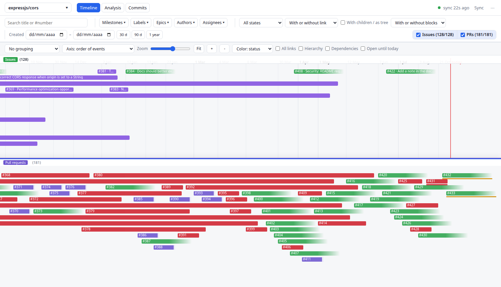
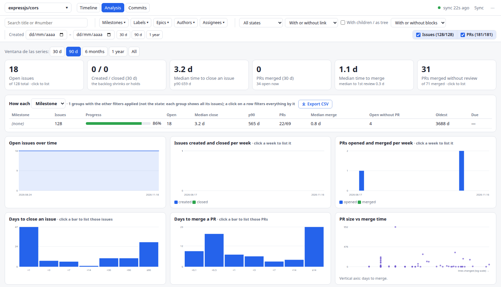

# issue-timeline

**See the whole story of your backlog.** issue-timeline turns the issues and pull/merge requests of your GitHub and
GitLab projects into an interactive timeline: when work was opened, how it moved, what blocks what, and where the
bottlenecks are. Self-hosted, one command to run. Redmine, GitHub and GitLab issues can be edited from the app, in repos set to write.

[](https://www.npmjs.com/package/issue-timeline)
[](LICENSE)
[](go.mod)



```sh
npx issue-timeline@beta
```

One binary, with the web app inside (npm installs the build of your platform: Linux, macOS and Windows on x64, Linux and
macOS on arm64). It opens in your browser. Add `owner/repo` (GitHub) or `group/project` (GitLab) and the history loads in the background.
No account, no server to deploy, no runtime dependencies: it signs in with the `gh` and `glab` sessions you already have.

> **Beta.** The local API has no authentication and storage is plain JSON, so run it on `127.0.0.1` (the default) or
> behind your own access control. Until the first stable release `npx` needs the `@beta` tag. See [Status](#status).

---

## Why

Issue lists tell you what is open today. They don't tell you how the work actually flowed. issue-timeline does:

- **See bursts and droughts.** Work arrives in waves. A horizontal timeline shows every issue and pull request as a bar
  from creation to close or merge, so you can spot the week everything stalled.
- **Read dependencies at a glance.** Blockers are drawn as arrows, blocked items are marked, and each item shows how many
  open issues sit behind it, all the way down the chain.
- **Track epics without guessing.** Progress is computed from the real state of each child, not from checkboxes someone
  forgot to tick. Sub-issues and task lists both count.
- **Answer the questions that matter.** Open issues over time, created vs closed per week, days to close, days to merge,
  PRs merged without review, the oldest open issues, and per-milestone, per-label or per-author breakdowns.
- **Share a view.** Filters live in the URL. Copy it, send it, reload it, and your teammate sees exactly what you see.



## Features

### Timeline
- Horizontal, draggable timeline with logarithmic zoom and a one-click fit.
- Two time axes: **event order** (every creation, close or merge gets the same width, so nothing is hidden by a long
  quiet period) and **real time**, with idle stretches collapsed into a "N days without activity" marker.
- Open items fade into the present; closed items keep their full length.
- Issue ↔ pull request links, highlighted on hover or selection.
- Filters by text, state, milestone, labels (any or all), authors, assignees, dates, and linked/unlinked PRs.
- Group rows by milestone, label or author. The axis adapts to what is on screen.

### Hierarchy and dependencies
- **Epics and children:** native GitHub sub-issues, GitLab epics and parent/child work items, and the task lists
  written in epic descriptions. Parents show a `▸closed/total` counter and a progress line; their children light up on
  hover.
- **Blockers:** native relations (GitHub "blocked by / blocks", GitLab issue links "blocks / is blocked by") and
  plain-language references in descriptions ("Depends on #N", "Blocked by #N", "Blocks #N", "Depende de #N"…). Red
  arrows for open blockers, grey dashed for resolved ones. The words are a [vocabulary](#vocabulary) you can extend.
- **Chain analysis:** how many issues are stuck behind each blocker, transitively.

### Analysis
- Open issues over time, created vs closed per week, PRs opened and merged per week.
- Time to close and time to merge, with medians and p90. PR size against merge time.
- Issues with and without a linked PR. PRs merged without a review.
- A comparison table for every milestone, label, author or assignee: progress, open, median and p90 close time, merged
  PRs, open without PR, oldest open item and due dates. Click a row to filter the whole app by it. Export it as CSV.

### Commits and CI
- The default branch's commits, tied to issues and PRs by the `#N` in their title, with the files each one changed.
- How each PR was merged (squash, rebase, merge commit) and its CI runs: GitHub Actions runs and GitLab pipelines, plus
  the commits that changed the CI definition.

## Requirements

- **Node.js 18 or newer** to install it with npm (it only starts the binary), or nothing at all with a binary built
  from source (**Go 1.26** and Node.js 22 with npm, see [Development](#development)).
- For GitHub, the [GitHub CLI](https://cli.github.com) signed in (`gh auth login`) or a `GITHUB_TOKEN`.
- For GitLab, the [GitLab CLI](https://gitlab.com/gitlab-org/cli) signed in (`glab auth login`) or a `GITLAB_TOKEN`.
- For Redmine or Jira Cloud (optional, trackers), an API key or an API token. See [Trackers](#trackers-and-linked-code-repos).

You need only the one you use.

## Usage

```sh
npx issue-timeline@beta              # run in the foreground and open the browser
npx issue-timeline@beta --background # keep running after you close the terminal
npx issue-timeline@beta stop         # stop the background one
npm install -g issue-timeline@beta   # or install it, then: issue-timeline
```

| Option             | What it does                                                            |
| ------------------ | ----------------------------------------------------------------------- |
| `-b`, `--background` | Run detached. Logs go to `issue-timeline.log` in the data folder.     |
| `--no-open`        | Do not open the browser (it is also skipped in CI and without a terminal). |
| `-h`, `--help`     | Show the help.                                                          |

On start it prints where to open it, where the data lives, and which sessions it found:

```
issue-timeline is running
  Open:   http://127.0.0.1:4310
  Repos:  none yet, add one from the page
  Data:   ~/.local/share/issue-timeline
  Auth:   uses your gh and glab sessions (read-only)
          GitHub: gh session
          GitLab: not signed in. Run `glab auth login` or set GITLAB_TOKEN
```

### Docker

To keep it running without a terminal, use the container. It needs no Node, and the settings stay in one file:

```sh
cp .env.example .env          # fill in what you use: PUBLIC_URL, the OAuth apps, a GITHUB_TOKEN...
docker compose up -d          # build the image and start it, in the background, restarted after reboots
docker compose logs -f        # the log; the page is at http://127.0.0.1:4310
docker compose exec issue-timeline issue-timeline credentials set redmine-api-key   # secrets, if you use them
```

The data lives in the `issue-timeline-data` volume (`/data` in the container). Inside the container there is no `gh` or
`glab` session, so set `GITHUB_TOKEN` and `GITLAB_TOKEN` in `.env`, or sign in with the OAuth apps. The published port is
on `127.0.0.1` only; to reach the server from other machines, put a reverse proxy in front with `PUBLIC_URL` and
`ALLOWED_HOSTS` set, as in [Sign-in with GitHub and GitLab](#sign-in-with-github-and-gitlab).

### Adding repositories

From the page, pick the provider and type:

- **GitHub:** `owner/repo`, or paste the repository URL.
- **GitLab:** `group/project`, or the full URL of a self-managed instance (`https://gitlab.example.com/group/project`).
- **Redmine (tracker):** the project URL, `https://redmine.example.com/projects/<identifier>`.
- **Jira Cloud (tracker):** the project URL, `https://<site>.atlassian.net/jira/software/projects/<KEY>/board`.

A repository is saved only after the host confirms it exists and your login can read it. Add as many as you want and
switch between them from the header.

### Authentication

issue-timeline uses the sessions you already have, so there is nothing to configure for GitHub and GitLab. It reads with
them, writes only to repos you switch to write mode, and never stores those tokens. The Redmine and Jira secrets are the exception, and they are kept as described below.

- **GitHub:** `gh auth login`, or set `GITHUB_TOKEN`. Private repositories need the `repo` scope.
  For **GitHub Enterprise Server** set `GITHUB_HOST` (for example `github.example.com`), one instance per run.
- **GitLab:** `glab auth login` once per instance, or set `GITLAB_TOKEN` (GitLab.com) / `GITLAB_TOKEN_<HOST>` for a
  self-managed instance, for example `GITLAB_TOKEN_GITLAB_EXAMPLE_COM`. Environment tokens need no CLI, so they work in
  containers and on servers.
- **Redmine and Jira Cloud** keep their secrets in the same place as the CLIs do, with one command per secret:

  ```sh
  issue-timeline credentials set redmine-api-key   # your Redmine API key (My account > API access key)
  issue-timeline credentials set jira-email        # the Atlassian account email
  issue-timeline credentials set jira-api-token    # an API token (id.atlassian.com > Security > API tokens)
  issue-timeline credentials list                  # which are set, and where: never their values
  issue-timeline credentials clear jira-api-token
  issue-timeline credentials set redmine-api-key https://redmine.example.com   # a secret for one site
  ```

  **Each secret belongs to one site.** One set with a site (as in the last line) is only sent to that site. One set
  without a site is bound to the first site it is used with, and is never sent to another one after that: adding a repo
  of another site asks for a secret of its own. `credentials list` shows which site each one is for.

  The value is typed in hidden, or piped on stdin. It never goes in an argument, the shell history or the store. It goes
  to the OS keyring (`secret-tool` on Linux) when there is one; otherwise to `credentials.json` in the data folder,
  readable only by your user. That file is not encrypted, so the keyring is the better place. The environment variables
  `REDMINE_API_KEY`, `JIRA_EMAIL` and `JIRA_API_TOKEN` still work, as a last resort for CI, but they can end up in the
  shell history and in the process list.

### Configuration

| Variable        | Default                | Purpose                                                           |
| --------------- | ---------------------- | ----------------------------------------------------------------- |
| `PORT`          | `4310`                 | HTTP port                                                         |
| `HOST`          | `127.0.0.1`            | Bind address. Off loopback every request needs a sign-in (see below). |
| `ALLOWED_HOSTS` | none                   | Extra host names the server answers to (comma-separated), e.g. the name a proxy serves it under. Any other `Host` header is refused. |
| `COOKIE_SECURE` | `0`                    | `1` adds `Secure` to the session cookie (also automatic when a proxy sends `X-Forwarded-Proto: https`). |
| `SESSION_IDLE_HOURS`, `SESSION_MAX_DAYS` | `12`, `7` | A session ends after this long without a request, or this long after the sign-in. |
| `STORE_DIR`     | user data folder       | Where repository data and the repo list are kept (see below)      |
| `POLL_MINUTES`  | `5`                    | Sync interval                                                     |
| `CI_DAYS`       | `90`                   | How many days of CI runs are kept                                 |
| `GITHUB_TOKEN`  | from `gh`              | GitHub token                                                      |
| `GITHUB_HOST`   | `github.com`           | GitHub Enterprise Server host (REST and GraphQL URLs follow)      |
| `GITLAB_TOKEN`  | from `glab`            | GitLab.com token. `GITLAB_TOKEN_<HOST>` for other instances.      |
| `VOCABULARY_FILE` | built in             | Your own words for dependencies, fields and CI workflows         |
| `REDMINE_API_KEY` | from `credentials`   | Last-resort fallback for Redmine. Prefer `issue-timeline credentials set redmine-api-key`. |
| `JIRA_EMAIL`, `JIRA_API_TOKEN` | from `credentials` | Last-resort fallback for Jira. Prefer `issue-timeline credentials set …`. |
| `PUBLIC_URL`    | from the request       | The address people and hosts reach the server at (`https://timeline.example.com`): the base of the OAuth callback URLs. |
| `GITHUB_OAUTH_CLIENT_ID`, `GITHUB_OAUTH_CLIENT_SECRET` | none | A GitHub App (or OAuth App) for *Continue with GitHub*. See [Sign-in with GitHub and GitLab](#sign-in-with-github-and-gitlab). |
| `GITHUB_OAUTH_SCOPES` | `repo` | An OAuth App's scopes (a GitHub App ignores them: its permissions decide). |
| `GITLAB_OAUTH_CLIENT_ID`, `GITLAB_OAUTH_CLIENT_SECRET` | none | A GitLab application for *Continue with GitLab*. |
| `GITLAB_OAUTH_URL` | the repos' instance | The GitLab instance of that application, when the repos are on more than one (`https://gitlab.com` when there is none). |
| `GITLAB_OAUTH_SCOPES` | `api` | The application's scopes: `api` to edit, `read_api` to only read. |
| `WEBHOOK_SECRET` | none | Turns on `POST /api/webhook`, the one webhook every host posts to. See [Live updates and webhooks](#live-updates-and-webhooks). |

**Where the data lives.** `STORE_DIR` if set; otherwise the `./data` of the current folder if it already holds a
repository list; otherwise a folder of your user: `~/.local/share/issue-timeline` (Linux),
`~/Library/Application Support/issue-timeline` (macOS), `%APPDATA%\issue-timeline` (Windows). Running the command inside
a project never drops a data folder in it.

### Vocabulary

Issue bodies say things like "Depends on #12" or "Bloqueado por #9", and "Design: …" or "Diseño: …" lines. Those words
are a list in [`internal/derive/vocabulary.json`](internal/derive/vocabulary.json), with English, Spanish, Portuguese, French and
German by default. To use your own words, write a JSON file with any of these keys and set `VOCABULARY_FILE` to its
path. Each key you give replaces the default list for that key; the rest keep the defaults.

```json
{
  "blockedBy": ["waits for"],
  "blocks": ["unblocks"],
  "fieldKeys": ["Ticket", "Spec"],
  "ci": { "otherWorkflows": ["nightly", "deploy"] }
}
```

- `blockedBy`: phrases that mean "blocked by / depends on" (the issue is blocked by the number that follows).
- `blocks`: phrases that mean "blocks" (the number that follows is blocked by this issue).
- `fieldKeys`: keys shown as fields of the detail panel.
- `ci.otherWorkflows`: workflows that are not a PR's CI (releases, deploys, docs, ...), matched as whole words.

The same file is used by the frontend, which receives it with the data.

## How it works

A single Go binary polls GitHub (GraphQL), GitLab (REST), Redmine and Jira every few minutes and keeps one JSON file
per repository. The React frontend is embedded in the binary and served by the same process. The HTTP API is described
in [`api/openapi.yaml`](api/openapi.yaml) (served at `/api/openapi.yaml`, with docs at `/api/docs`).

- **First sync** reads the full history: issues and PRs/MRs with comments, events, commits and reviews/approvals. On
  GitHub the open, closed and merged items are read as parallel chains of pages, so a full read of a repository with
  about 300 issues and PRs takes **about 20 seconds instead of one and a half to two minutes**. GitLab is bound by its own rate limits
  (about seven requests per merge request), and the client waits them out.
- **Later syncs** walk newest-updated first and stop at the first item older than the last sync: usually one or two small
  queries.
- **Storage** is atomic: each write goes to a temporary file and is renamed over the old one, so a crash never leaves a
  half-written file. The files are easy to back up, inspect and move. An item with its comments and events takes about
  3 to 4 KB, so a repository with a thousand of them is a few megabytes.

### Why JSON and not a database

The files are small (about 3 to 4 KB per issue or PR, comments and events included) and the time of a sync is spent waiting
for the hosts, not writing to disk, so a database would not make it faster, and a database driver would give up the
single dependency-free binary. If a repository grows so large that rewriting its file hurts, that is the moment to
move it.

## API

- `GET /api/data`: lightweight records, links and sync status
- `GET /api/issues/:n`, `GET /api/pulls/:n`: full record for one item
- `POST /api/sync[?full=1]`: trigger a sync
- `GET /api/events`: what changes in a repo, as server-sent events (see [Live updates](#live-updates-and-webhooks))
- `POST /api/webhook`: the one webhook every host posts to

The full contract is [`api/openapi.yaml`](api/openapi.yaml), served with its docs at `/api/docs`.

**Who may use the API.** A request from this machine (loopback, with no proxy header) uses the local identity: your
`gh` and `glab` sessions and the stored credentials. Only such a request can add repos, link them, or use the local
identity to edit. Every other request needs a sign-in. A reverse proxy on the same machine must send `X-Forwarded-For`
(or `Forwarded` / `X-Real-IP`): without it, every request through the proxy looks like it comes from this machine. Any
other user account on this machine can also reach the loopback port, so do not run the server on a shared machine
without your own access control. The `Host` header must name this server (a loopback name, the bind address, this
machine's names and addresses, or `ALLOWED_HOSTS`), which blocks DNS rebinding. Writes also need the app's own header
and an `Origin` that matches the `Host`.

**Signing in and roles.** Each person signs in on the host of the repo they have open, from the *Sign in* button in
the header: on GitHub and GitLab with *Continue with GitHub/GitLab* when the server has an app there (see
[Sign-in with GitHub and GitLab](#sign-in-with-github-and-gitlab)), or with a pasted personal access token; on Redmine
with their API key. The button is not shown for a Jira repo (no sign-in yet). Only the sites this server reads are
accepted, and the key or token is checked there. It is kept in memory for that session only: a session ends after `SESSION_IDLE_HOURS` without use or
`SESSION_MAX_DAYS` after the sign-in, and a restart signs everyone out. A signed-in person only sees the repos their own
host gives them a role in, read again every few minutes. That role also decides what they may edit:

- **admin**: a Redmine administrator, a GitHub repo admin, a GitLab Owner. An admin may also switch the repo between
  read and write mode.
- **editor**: a Redmine member whose role is Manager or Developer (the default; set `{"editor": [...]}` in
  `roles.json` in the data folder), GitHub maintain, push or triage, GitLab Developer and up.
- **viewer**: any other member. Not a member: the repo is not shown.

Jira has no sign-in yet, so a signed-in person does not see Jira projects. A tracker's linked code repos only show up
for someone who may see them as well.

**What each person may see.** The records come from the sync, which reads with the server's own identity, so each
route filters them by what the person's own credential could read: GitLab confidential issues and internal notes,
Redmine private issues and private notes, and the code of a project a GitLab Guest cannot read, are hidden from whoever
could not open them on the host. The live updates follow the same rule (see [docs/server.md](docs/server.md)).

## Sign-in with GitHub and GitLab

With an app registered on the host, people sign in on the host's own page (*Continue with GitHub*, *Continue with
GitLab*) instead of pasting a token. The server sends them there with a random state and a PKCE challenge, takes them
back at `<PUBLIC_URL>/api/oauth/<github|gitlab>/callback`, and keeps their token in memory for the session. A token that
expires (GitLab's after two hours, a GitHub App's after eight) is renewed by the server before it does. Without an app,
the dialog asks for a personal access token, as before.

Set `PUBLIC_URL` to the address people open the app at (it must be in `ALLOWED_HOSTS` when it is not this machine): the
callback URL registered on the host must match it exactly.

### GitHub: a GitHub App (recommended)

A GitHub App's token can do only what the app's permissions allow, and only on the repos it is installed on. The same
app can also send the [webhook](#live-updates-and-webhooks) of every one of those repos.

1. **Settings → Developer settings → GitHub Apps → New GitHub App** (on your account, or on the organization:
   *Organization settings → Developer settings*).
2. **GitHub App name**: anything, for example `issue-timeline (acme)`. **Homepage URL**: your `PUBLIC_URL`.
3. **Callback URL**: `https://timeline.example.com/api/oauth/github/callback`. Leave *Expire user authorization tokens*
   on (the server renews them). Leave *Request user authorization (OAuth) during installation* off.
4. **Webhook**: on, with **Webhook URL** `https://timeline.example.com/api/webhook` and **Webhook secret** your
   `WEBHOOK_SECRET`; or off, if you set the webhooks per repo instead.
5. **Repository permissions**: *Issues* read and write, *Pull requests* read and write, *Contents* read, *Metadata*
   read (always on), *Actions* read (for CI). Read only, if no one edits from the app. **Account permissions**: none.
6. **Subscribe to events** (when the webhook is on): *Issues*, *Issue comment*, *Pull request*, *Pull request review*,
   *Pull request review comment*, *Push*, *Workflow run*.
7. **Where can this GitHub App be installed?** *Only on this account*. Create it.
8. On the app's page: copy the **Client ID**, and **Generate a new client secret**.
9. **Install App** → install it on the repos (or all repos) the server reads. A person signs in only through repos the
   app is installed on, and still only sees what their own role there allows.

```sh
GITHUB_OAUTH_CLIENT_ID=Iv23li… GITHUB_OAUTH_CLIENT_SECRET=… PUBLIC_URL=https://timeline.example.com npx issue-timeline@beta
```

**Or an OAuth App** (simpler, broader): *Settings → Developer settings → OAuth Apps → New OAuth App*, with the same
**Authorization callback URL**. Its token gets the `repo` scope (`GITHUB_OAUTH_SCOPES`), which reaches every repo the
person can, and does not expire. On GitHub Enterprise Server the steps are the same on your instance, with `GITHUB_HOST`
set.

### GitLab: an application

1. **User settings → Applications** (or a group's *Settings → Applications*, or *Admin → Applications* on a
   self-managed instance) → **Add new application**.
2. **Name**: `issue-timeline`. **Redirect URI**: `https://timeline.example.com/api/oauth/gitlab/callback`.
3. **Confidential**: on. **Scopes**: `api` (reading and editing; the server asks for it, `GITLAB_OAUTH_SCOPES`), or
   `read_api` if no one edits from the app.
4. **Save application**, and copy the **Application ID** and the **Secret**.

```sh
GITLAB_OAUTH_CLIENT_ID=… GITLAB_OAUTH_CLIENT_SECRET=… PUBLIC_URL=https://timeline.example.com npx issue-timeline@beta
```

The application is on the instance the repos are on (`GITLAB_OAUTH_URL` when they are on more than one). GitLab's
tokens last two hours; the server renews them with the refresh token GitLab gives, and a renewal that fails signs the
person out.

### Checking it

The *Sign in* dialog of a GitHub or GitLab repo shows *Continue with …* when the app is set up
(`GET /api/sign-in-options` says `"oauth": true`). If the host answers *redirect_uri mismatch*, the callback URL on the
host and `PUBLIC_URL` differ (scheme, host, port, a trailing slash). If the dialog comes back with "the sign-in was
not started in this browser", the browser dropped the `it_oauth` cookie, or more than ten minutes went by on the host's
page.

## Trackers and linked code repos

Redmine and Jira Cloud are **trackers**: their issues, their dates, their history and their dependencies come in. A
tracker has no code, so it gets pull requests, commits and mentions from the code repos (GitHub, GitLab) **linked** to it.

**Setting it up**

1. Add the tracker from *Add repository…* and the GitHub or GitLab repo the same way.
2. Open the project selector and pick **Linked code repos…** (it appears while a tracker is the current repo). Check the
   repos and save. Their pull requests and commits join the tracker, and the tracker's issues show them.

**How a pull request or commit names an issue.** The issue's key in the title, the branch or the commit messages:

- Jira: the key itself, for example `KAN-12` (the project key of that tracker).
- Redmine: `refs #12`, `fixes #12`, `closes #12` (or `resolves`). A bare `#12` does not count: in a linked repo it means
  the code repo's own number.

Only keys of issues that exist in the tracker link. A commit that names an issue appears in the **Commits** tab with
that issue as a chip. A pull request that names one links to it in the timeline.

**Dates.** Each issue shows its due date and its start date when the tracker has them, and an open issue past its due
date counts as overdue (the *Overdue* filter, and the list in *Analysis*).

- Redmine: the issue's start and due dates; the due date of a version is the milestone's date.
- Jira: the due date. The start date is read from the site's **Start date** field (a date field, found by name). A site
  without that field has no start dates: it is added by the Jira administrator.

**Limits, as they stand.**

- The first sync of a tracker reads each issue's history with one request per issue. It is slow on large projects, and
  later syncs only read what changed.
- A linked code repo's CI is not shown on the tracker yet.
- Mentions link through the Commits tab and the pull requests. A commit with a mention that is not in any pull request
  does not appear in the issue's own detail.
- A Redmine instance other than 5.x and a Jira site other than Cloud (API v3) are untested.

**Editing Redmine issues.** A Redmine issue has an *Edit* button in its panel. The form has the fields of Redmine's own
form: title, description, status, dates, tracker, priority, assignee, version, category, progress, estimated hours, parent,
relations (add and remove), custom fields in the format each one has, and a comment. Only what changed is sent, and the
panel reads the issue back from Redmine once it is saved. Writes need the app's own header, and the local API refuses
writes from any other origin. Jira issues are read-only for now.

**Editing GitHub and GitLab issues.** The same panel edits title, description, state, labels, assignees and milestone, and
GitLab's due date, plus a comment. Each change goes to the host first, and the panel shows what the host now says. The
person's role comes from GitHub's own permissions for the repo (admin, maintain, push or triage edit; pull reads) or from
GitLab's access level in the project (Developer and up edit). Without a sign-in, on this machine, the local identity
(`gh` or `glab`) edits, as before.

Also on GitHub and GitLab: **relations** (blocks, blocked by, and relates to on GitLab, which GitHub does not have), the
**parent** (sub-issues on GitHub; on GitLab, a work item's parent, which the plan and the item type must allow), and
**New issue**. GitLab's "blocks" links need a paid plan; the host's own message says so when it is not available.

Also: pull and merge requests (title, description, state, labels, assignees, milestone, reviewers and draft), GitHub's
close reason and lock, GitLab's confidential flag, weight, time and notes, Redmine's private notes and private issues,
watchers, time entries and files (up to 5 MB each). Anything a host does not keep (a weight on a free GitLab plan, for
example) is reported back as a warning instead of being shown as saved.

## Status

issue-timeline is in **beta**. What is left before `1.0.0`:

- Protect the API when it is bound to anything other than the loopback address.
- Test on macOS and Windows (the data folder and browser opening are written for them, but nobody has run it there yet).
- Try it against a GitHub Enterprise Server instance.

## Live updates and webhooks

Every open page follows `GET /api/events` (server-sent events): when someone edits a record from the app, when a sync
starts or ends, the server tells the pages open on that repo and they read the data again. The header shows **live**
while the stream is open; if a proxy drops it, the page falls back to reading every 30 seconds and the browser
reconnects on its own. An event names records, never their content, and a person is not told about records they may not
see. A reverse proxy must not buffer `/api/events` (the server sends `X-Accel-Buffering: no` for nginx).

The hosts can tell the server too, so a change made on GitHub or GitLab shows in seconds instead of at the next poll.
There is **one webhook for every host**, at one address, with one secret.

### 1. Turn it on

```sh
export WEBHOOK_SECRET=$(openssl rand -hex 32)   # keep it: every host gets the same one
PUBLIC_URL=https://timeline.example.com ALLOWED_HOSTS=timeline.example.com npx issue-timeline@beta
```

The host must reach the server: give it a public HTTPS address (a reverse proxy, or a tunnel such as `cloudflared` or
`ngrok` for a machine at home), and add that name to `ALLOWED_HOSTS`, or the server refuses the delivery (421). Only
`/api/webhook` needs to be reachable from outside; a proxy can limit the rest to your network.

### 2. Point each host at `https://timeline.example.com/api/webhook`

**GitHub** (per repo, per organization, or once in a [GitHub App](#github-a-github-app-recommended) for every repo it is
installed on):

1. Repo → **Settings → Webhooks → Add webhook** (organization: *Settings → Webhooks*).
2. **Payload URL**: `https://timeline.example.com/api/webhook`. **Content type**: `application/json`.
3. **Secret**: your `WEBHOOK_SECRET`. **SSL verification**: on.
4. **Which events?** *Let me select individual events*: Issues, Issue comments, Pull requests, Pull request reviews,
   Pull request review comments, Pushes, Workflow runs (or *Send me everything*).
5. **Add webhook**. GitHub sends a `ping` at once: *Recent Deliveries* shows it with a 202.

**GitLab** (per project; per group needs GitLab Premium):

1. Project → **Settings → Webhooks → Add new webhook**.
2. **URL**: `https://timeline.example.com/api/webhook`. **Secret token**: your `WEBHOOK_SECRET`.
3. **Trigger**: Push events, Comments, Confidential comments, Issues events, Confidential issues events, Merge request
   events, Pipeline events.
4. **SSL verification**: on. **Add webhook**, then **Test → Issues events**: the answer shows `202`.

**Jira Cloud** (a Jira administrator):

1. **Settings → System → WebHooks → Create a WebHook**.
2. **URL**: `https://timeline.example.com/api/webhook`. **Secret**: your `WEBHOOK_SECRET` (Jira then signs every
   delivery, which the server checks).
3. **Events**: Issue created, updated, deleted; Comment created, updated, deleted; Issue link created and deleted.
   Optionally a JQL filter such as `project = PROJ`.

**Redmine, or anything else**: Redmine has no webhooks of its own. A plugin such as
[redmine_webhook](https://github.com/suer/redmine_webhook) posts to the URL with `?token=<WEBHOOK_SECRET>` (it cannot
set a header; the secret then shows in logs and URLs, so prefer a proxy that adds the header). A script posts:

```sh
curl -X POST https://timeline.example.com/api/webhook \
  -H "X-Issue-Timeline-Token: $WEBHOOK_SECRET" -H "Content-Type: application/json" \
  -d '{"repo": "redmine:https://redmine.example.com/backend"}'
```

The `repo` is the repo key, as `GET /api/repos` lists it: `owner/name`, `gitlab:https://gitlab.com/group/project`,
`redmine:https://redmine.example.com/project`, `jira:https://acme.atlassian.net/PROJ`.

### 3. What happens with a delivery

A delivery is only a signal: the server syncs the repo it names about two seconds later (a burst of deliveries is one
sync), with the same code as every sync, and keeps nothing of the payload. The pages open on the repo hear about it
through `/api/events` and read the data again. While a repo's host sends deliveries, the periodic poll (`POLL_MINUTES`)
leaves it alone; if they stop for 30 minutes, the poll comes back on its own.

| The host shows | Why |
| --- | --- |
| `202` | Accepted. `repos` in the answer lists the configured repos it syncs (empty for a ping, or for a repo this server does not read). |
| `401` | The secret does not match, or the delivery is not signed. Paste the same `WEBHOOK_SECRET` on the host. |
| `404` | The server runs without `WEBHOOK_SECRET`. |
| `421` | The address the host used is not in `ALLOWED_HOSTS`. |
| no answer, timeout | The host cannot reach the server: the tunnel or the proxy. |

## Roadmap

- Editing from the timeline (labels, close, comment) through GraphQL mutations
- Project and milestone events
- Velocity per person
- SQLite storage once the JSON files outgrow it

## Notes

- The interface is in English. Issue bodies are read with the vocabulary above (English, Spanish, Portuguese, French,
  German by default); another language needs `VOCABULARY_FILE`.
- A dependency written only in a comment is not read.
- Links from commits are read from the title: a "#N" that matches an issue links the commit to it. This is a heuristic.
- A GitLab issue's links are read when the issue is synced. If a link added later does not show after an incremental sync,
  a full sync (`POST /api/sync?full=1`) reads it.
- Hierarchy on GitLab comes from the work items API, so it needs a version that has it.

## Development

```sh
git clone https://gitlab.com/system4us/issue-timeline.git
cd issue-timeline
make deps                      # the web app's dependencies (npm)
make build                     # web app + server: bin/issue-timeline
make dev                       # the server from source, on :4310
cd web && npm run dev          # Vite on :5173, proxied to the server
make test                      # Go (-race), web (Vitest) and the end-to-end test
make npm VERSION=1.0.0-beta.5  # the npm packages, into dist/npm (CI publishes them on a v* tag)
make                           # every target
```

Contributions are welcome. See [CONTRIBUTING.md](CONTRIBUTING.md). The development happens on
[GitLab](https://gitlab.com/system4us/issue-timeline); the GitHub repository is a read-only mirror.

## License

[MIT](LICENSE)
